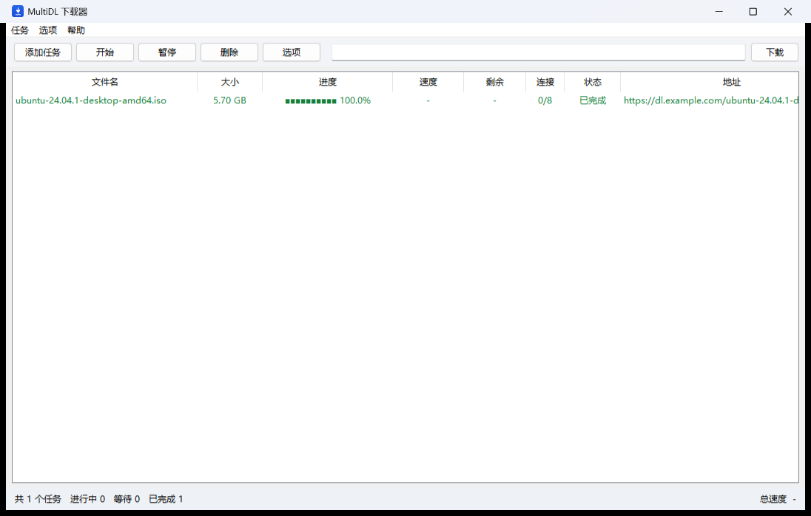

# MultiDL

轻量、纯 Python 的 Windows 桌面下载器。多线程分段下载、断点续传、单文件 exe，**双击即用**——无需安装、无需 Python、无需任何许可。

> 本项目为**独立实现**：不含任何第三方商业软件的代码、资源或算法，也不涉及任何许可绕过。
> 只用公开协议：HTTP/1.1 Range（RFC 7233）、FTP REST（RFC 959）、HLS（RFC 8216）。



---

## 快速开始

1. 到 [Releases](../../releases) 下载 `MultiDL.exe`
2. 双击运行

> **首次运行提示**：程序未做代码签名，Windows 会弹「Windows 已保护你的电脑 / 未知发布者」——点「更多信息 → 仍要运行」即可。这不是病毒，exe 是 PyInstaller 打包的自包含程序，源码就在本仓库，可自行编译核对。
>
> **托盘常驻**：关闭窗口**不会退出**，程序会缩到右下角托盘继续在后台跑；要真正退出请用托盘图标右键菜单「退出」。托盘图标若没直接显示，点任务栏的 `^` 展开溢出区即可看到，也可拖到可见区固定。

首次启动自动创建：

- 下载目录 `%USERPROFILE%\Downloads\MultiDL`
- 数据目录 `%LOCALAPPDATA%\MultiDL`（任务列表 + 断点信息）

命令行参数（都可选）：

```bat
MultiDL.exe --dir D:\Downloads --conn 16 --parallel 4 --speed 2048
MultiDL.exe "https://example.com/big.iso"      :: 带 URL 直接开始
MultiDL.exe --port 0                            :: 关掉浏览器扩展端口
```

| 参数 | 说明 |
|---|---|
| `--dir` | 保存目录 |
| `--data` | 数据目录 |
| `--conn` | 每任务连接数，**0 = 自动**（按文件大小，约 4MB/连接，上限 32） |
| `--proxy` | 代理 `host:port`（如 `127.0.0.1:7890`）；默认读 Windows 系统代理；`none` = 强制直连 |
| `--parallel` | 同时下载任务数（默认 3） |
| `--speed` | 全局限速 KB/s，0 = 不限 |
| `--port` | 浏览器扩展端口，默认 8765，0 = 关闭 |
| `--tray` | 启动后只驻留系统托盘，不弹出主窗口（适合开机自启） |

---

## 性能实测

测试方法：本地 HTTP 服务器对每个 64 KB 响应块延迟 50 ms（单连接 ≈ 1.24 MB/s），
**连接数是唯一变量**，40 MB 文件，各跑 3 轮取中位数。所有结果都用 SHA-256 与源文件逐字节比对。

| 方案 | 耗时 | 吞吐 | 相对单连接 |
|---|---|---|---|
| 单连接 | 32.32 s | 1.24 MB/s | 1.0x |
| **MultiDL（8 连接）** | **5.08 s** | **7.87 MB/s** | **6.4x** |

想自己复现：

```bash
python test/range_server.py --port 8898 --slow 0.05 --file "big.bin=test/big.bin"
python test/bench.py
```

---

## 操作

| 操作 | 方式 |
|---|---|
| 加任务 | 工具栏输入框回车 / 「添加任务」/ `Ctrl+N`（支持一行一个批量） |
| 开始下载 | 添加时自动开始；暂停后点「开始」或双击 |
| 暂停 / 继续 | 选中行 → 「暂停」/「开始」，右键菜单同样有 |
| 删除 | `Del`，会问「是否连文件一起删」 |
| 打开文件 | 双击任务行 |
| 打开所在文件夹 | 右键 → 打开所在文件夹 |
| 复制下载地址 | 右键 → 复制下载地址 |
| 全部开始 / 全部暂停 | 「任务」菜单 |
| 改设置 | 「选项」→ 目录 / 并发 / 连接数 / 限速 / 剪贴板监视 |
| 剪贴板监视 | 复制一个 http(s)/ftp 链接，自动弹窗问要不要下载（「选项」里可关） |
| 列排序 | 点表头 |

防盗链站点在「添加任务」里填 Referer 即可。

---

## 浏览器接管（可选）

`extension/` 是一个 Chrome / Edge 的 MV3 扩展，可以把浏览器的下载交给本地客户端。

**这是可选功能，装不装都能正常用 exe 手动下载。** 想装的话见 [`extension/README.md`](extension/README.md)（含独立、逐步的安装说明）。

一句话原理：扩展监听 `chrome.downloads.onCreated`，把 URL 转给本地客户端（`127.0.0.1:8765`），
客户端没启动时扩展会自动放行，不影响浏览器正常下载。

---

## 功能特性

- ✅ 多线程分段下载（按 4 MB/连接铺满，最大 32 连接）
- ✅ 断点续传（ETag / Last-Modified + If-Range 门禁）
- ✅ 暂停 / 继续 / 取消
- ✅ 单文件定位写，无「分块合并」阶段
- ✅ 全局限速（令牌桶）
- ✅ 并发任务队列（可配置 1–10）
- ✅ 服务器不支持 Range 时自动降级单连接
- ✅ FTP（单连接 + REST 续传）
- ✅ HLS（m3u8，未加密流；加密流明确报错）
- ✅ 剪贴板监视
- ✅ 防盗链 Referer / Cookie
- ✅ 浏览器接管（可选扩展）
- ✅ 系统托盘常驻（关闭窗口缩到右下角，托盘菜单可暂停 / 继续 / 退出）
- ✅ 代理支持（默认读 Windows 系统代理，Clash 等自动生效；可 `--proxy` 指定；本地地址直连）
- ✅ 界面底部可切换网络模式：**自动 / 直连 / 代理**（默认自动，选择会记住）
  - 自动：读 Windows 系统代理，系统没开代理就直连
  - 直连：强制不走代理（本地/内网下载、排查代理问题时用）
  - 代理：强制走系统里存过的代理地址（即使系统代理开关是关的），本地地址仍直连
- ✅ 反反爬兜底：引擎失败（403 / 空响应 / 被拦）时，自动用 curl_cffi（Chrome TLS 指纹）再试一次（先代理、后直连）；仍不通才判「被墙」
- ✅ 未知长度（chunked）响应支持：边下边写，不受 Content-Length 限制；对镜像站返回的 0~1 字节「假响应」会识别为拦截并重试，不会生成假文件
- ✅ 速度可视化：每个任务一条实时速度曲线（柱状 sparkline），状态栏汇总总速度 / 总剩余 / 总体进度
- ✅ 剩余大小显示：按「总大小 − 已下载」实时计算，未知长度时显示「未知」

---

## 为什么快

1. **单文件预分配 + 各连接独立句柄定位写**
   不做「分块临时文件 → 完成后合并」。大文件少读一遍、少写一遍，省掉整趟磁盘往返。
2. **一次铺满连接数**（`4 MB / 连接`，上限取用户设置）
   没有逐步增连的爬坡期。
3. **256 KB 单次 recv**
   `readinto` 直接读进预分配 buffer，减少 Python 层循环次数。
4. **`Accept-Encoding: identity`**
   避免服务端 gzip 导致字节数对不上、分段失效。
5. **I/O 在 C 层**
   socket 读写与文件写都会释放 GIL，多条连接真正并行，不是伪多线程。

---

## 目录结构

```
multidl/
├─ dist/MultiDL.exe        打包好的单文件程序（构建产物）
├─ main.py                  入口（GUI + 可选本地 API）
├─ engine/
│  ├─ core.py               分段 / 连接 / 调度 / 限速 / 定位写
│  ├─ manager.py            持久化、并发槽位、生命周期
│  ├─ ftpdl.py              FTP（REST 续传）
│  └─ hls.py                HLS 分段下载
├─ gui/app.py               tkinter 界面
├─ server/api.py            本地 HTTP API（给浏览器扩展用）
├─ extension/               Chrome/Edge MV3 集成（含独立 README）
├─ assets/icon.ico          图标（tools/make_icon.py 生成）
├─ tools/                   截图、图标等辅助脚本
└─ test/                    测试服务器 + 回归套件 + 性能对比
```

---

## 从源码运行 / 自己打包

运行：

```bat
python main.py
```

打包（需要 Python 3.10+ 且**带 tkinter**，官方安装包默认带）：

```bat
python -m venv .venv
.venv\Scripts\pip install -r requirements.txt   :: 可选：curl_cffi 反反爬兜底
.venv\Scripts\pip install pyinstaller
.venv\Scripts\python -m PyInstaller --noconfirm --onefile --windowed ^
    --name MultiDL --icon assets/icon.ico ^
    --add-data "assets/icon.ico;assets" --paths . main.py
```

> 小提示：单文件 exe 容易被杀软启发式误报。介意的话可以去掉 `--onefile` 改用目录模式（`--onedir`），误报率会低很多。

---

## 测试

```bash
# 起测试服务器（Range / 受控速率 / 不支持 Range）
python test/range_server.py --port 8899 --file "big.bin=test/big.bin"
python test/range_server.py --port 8896 --slow 0.15 --file "big.bin=test/big.bin"
python test/range_server.py --port 8897 --no-range --file "big.bin=test/big.bin"

python test/t_engine.py     # 5 项回归
python test/bench.py        # 性能对比
```

回归覆盖：多线程内容一致性（SHA-256）、无 Range 降级、暂停冻结与续传、全局限速、404 错误态。

---

## 已知限制

1. 不支持 HTTP/2（`http.client` 只到 1.1）——多连接足以打满带宽，单文件下载影响很小。
2. 代理：默认读 Windows 系统代理（Clash 等会自动生效），也可 `--proxy` 指定；本地地址（127.0.0.1）始终直连。
3. 长度未知的流（chunked 无 Content-Length）只能单连接顺序下载，进度显示为未知。
4. HLS 仅支持未加密流。
5. 界面是 tkinter，观感朴素；功能路径完整。
6. 浏览器接管依赖扩展，覆盖不到未装扩展的浏览器。

---

## 遇到问题 / 反馈

出错时程序会**自动把详细信息写进本地日志**，并弹窗告诉你日志在哪：

- 日志目录：`%LOCALAPPDATA%\MultiDL\logs\`（`multidl.log` 滚动保留，`crash.log` 记崩溃）
- 界面里：菜单「**帮助 → 打开日志文件夹**」直接定位
- 界面里：菜单「**帮助 → 复制诊断信息（反馈用）**」——把环境和最近日志一次性复制到剪贴板

反馈 bug 时，把「复制诊断信息」的内容（或上面两个日志文件）贴到 [Issues](../../issues) 里即可。仓库里带了 Issue 模板，按提示填就行。

> 程序打不开（双击没反应）怎么办：打开 `%LOCALAPPDATA%\MultiDL\logs\crash.log`，里面通常有崩溃原因；把它贴到 Issue 里。

---

## 授权

[MIT](LICENSE) —— 可自由使用、修改、分发。不含任何第三方商业软件代码。
